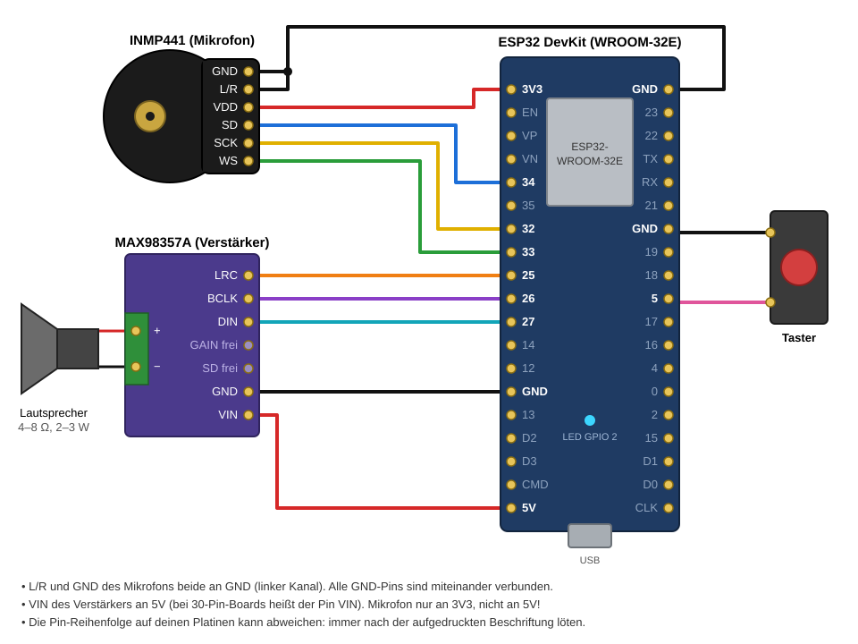

# Sprachassistent

Sprachassistent mit Persönlichkeit und Gedächtnis. ESP32 dienen als Mikrofon und Lautsprecher, die Arbeit macht der Raspberry Pi 5. Jeder ESP ist ein eigenes Gerät mit eigener Stimme, Persönlichkeit und eigenem Gedächtnis; alles wird im Adminbereich unter https://sprachassistent.plenivo.de eingestellt.

```
ESP32 (INMP441, MAX98357A, Taster)
  │  POST /v1/talk  (16 kHz PCM, chunked, ESP-Schlüssel) → Rahmen: Audio und Status für die LED
  ▼
sprachassistent.plenivo.de ─ nginx
  ├─ /v1/talk, /v1/health ─ 127.0.0.1:3020  Rust-Sprachserver (axum)
  │     ├─ Spracherkennung  Kroko, live beim Sprechen (sherpa-onnx)  lokal
  │     ├─ KI               Anbieter aus der DB, mit Fallback      extern, nur Text
  │     └─ Sprachausgabe    Piper-Stimmen (sherpa-onnx), je Gerät   lokal
  ├─ /v1/*            ─ 127.0.0.1:3022  Web-API (Node, veit-framework)
  │     Konten, ESP-Schlüssel, Geräte, KI-Anbieter, Gedächtnis, Einstellungen
  └─ /                ─ Adminbereich (React, veit-framework)
Postgres: Einstellungen, Anbieter, Geräte, Gedächtnis je Gerät, Konten und Schlüssel
```

Nur Text verlässt das Heimnetz. Laufende Kosten: Strom für den Pi und die Gratis-Kontingente von Groq oder Gemini.

Die Spracherkennung nutzt das deutsche Streaming-Modell von [Kroko (Banafo)](https://huggingface.co/Banafo/Kroko-ASR) unter CC-BY-SA; `deployments/pi/download-models.sh` lädt es.

## Struktur

```
src/                 Rust-Sprachserver
  api.rs             /v1/talk, /v1/health und interne Routen für den Adminbereich
  store.rs           Postgres: Geräte, Gedächtnis, Anbieter, ESP-Schlüssel prüfen
  assistant.rs       Prompt und Persönlichkeit je Gerät, Regeln nur für angebotene Werkzeuge
  context.rs         Gedächtnis: Kontext (500 Zeichen), den das Modell nach der Antwort selbst neu schreibt
  speech.rs          Live-Spracherkennung (Kroko) und Piper-Stimmen über sherpa-onnx (Feature speech)
  llm.rs             OpenAI-kompatible Anbieter mit Fallback, Streaming
  tools.rs           Werkzeuge: Internetrecherche über selbstgehostetes SearXNG, MCP-Werkzeuge
  web.rs             Seiten lesen (follow): nur öffentliche https-Adressen, Links mit Titel
  page.rs            HTML als knapper Text ohne Kopf, Menüs und Linklisten
  browser.rs         Headless-Chromium für JavaScript-Seiten, Proxy nur zu öffentlichen Adressen
  sentences.rs       Antwort-Stream in Sätze zerlegen
db/migrations/       Nummerierte SQL-Migrationen, je einmal angewandt von apps/api (pnpm --filter @sprachassistent/api migrate)
apps/api/            Web-API: @veit/auth-server, @veit/api-keys, Admin-Routen
apps/web/            Adminbereich: @veit/react-auth, -account, -api-keys, -controls
veit-framework/      Submodule (Pin origin/development)
firmware/            ESP32 (PlatformIO, Arduino)
deployments/build/   Cross-Compile für den Pi (Docker, Debian bookworm → aarch64)
deployments/pi/      Bootstrap, Runtime-Reload, nginx, pm2, Modell-Download
```

## Konfiguration

In `.env` steht nur `DATABASE_URL` (Vorlage `.env.example`). Alles andere liegt in der Datenbank und wird im Adminbereich gepflegt:

| Tab | Inhalt |
|---|---|
| Geräte | Name, Stimme, Sprechtempo, Persönlichkeit, bevorzugter KI-Anbieter; Testchat und Vorlesen; Kontext ansehen, bearbeiten, löschen; Verlauf ansehen und löschen |
| ESP-Schlüssel | API-Keys von `@veit/api-keys` mit der Berechtigung `device.talk`, beschränkt auf Geräte |
| KI-Anbieter | OpenAI-kompatible Endpunkte (Groq, Gemini, OpenRouter, Ollama …) mit Key, Modell, Reihenfolge; Test-Button |
| Einstellungen | Registrierung, SMTP, Whisper-Modell und Threads |

Das erste Konto, das sich registriert, wird Admin; danach ist die Registrierung geschlossen.

Die Internetrecherche (`web_research`, Aktionen `news` und `search`) fragt nur das selbstgehostete SearXNG unter `SEARXNG_URL` (Standard `http://127.0.0.1:8888`), das JSON-Format muss an sein. Auf dem Pi läuft es als Docker-Container `sprachassistent-searxng` mit `deployments/pi/searxng/settings.yml`; `deployments/pi/searxng.sh` richtet ihn bei Bootstrap und jedem Deploy ein. Ist SearXNG nicht erreichbar, meldet das Werkzeug einen Fehler, es gibt keine andere Suchquelle.

Der Agent erkennt Werkzeuge nie am Namen. Jedes eingeschaltete Werkzeug eines Chatbots geht an das Modell; was ein Chatbot nicht nutzen soll, wird in seiner Werkzeugverwaltung abgeschaltet. Wie der Agent ein Werkzeug behandelt, folgt allein aus den MCP-Annotationen: `readOnlyHint: true` liest (mit `openWorldHint: true` liest es von außen, darf länger dauern, längere Ergebnisse liefern und mehrere Schritte nacheinander machen), `readOnlyHint: false` ändert etwas und wartet, solange es ein Lesewerkzeug gibt, auf einen Blick auf den Stand; ohne Annotation wird nichts angenommen. Eine längere Anleitung zu einem Werkzeug (`ToolOffer::guide`, bei `web_research` in `tools.rs`) steht im Systemprompt, solange es angeboten wird.

`follow` liest eine Seite oder bis zu drei auf einmal und hängt die Links aus dem Inhalt samt Titel an, denen das Modell weiter folgen kann. Liefert eine Seite kaum Text oder wird der Abruf abgelehnt, lädt sie ein Headless-Chromium (`BROWSER_BIN`, sonst `/usr/bin/chromium`). Chromium läuft nie als root, sondern per `setpriv` als `sprachassistent-browser` mit eigener Sandbox, ohne Bilder, und erreicht das Netz nur über einen Proxy im Sprachserver, der ausschließlich https zu öffentlichen Adressen durchlässt. `deployments/pi/browser.sh` installiert Chromium und legt das Konto an.

## API für die ESPs

| Methode | Pfad | |
|---|---|---|
| GET | `/v1/health` | Datenbank, Spracherkennung, installierte Stimmen, Anbieter mit Key |
| POST | `/v1/talk` | Audio rein (rohes s16le 16 kHz oder WAV), gesprochene Antwort raus. `Authorization: Bearer spa_…`. `?format=wav` für WAV, `?device=<id>` wenn der Schlüssel mehrere Geräte abdeckt. Header `X-Sample-Rate`, `X-Transcript` |

```bash
curl -H "Authorization: Bearer $ESP_KEY" --data-binary @frage.wav   "https://sprachassistent.plenivo.de/v1/talk?format=wav" -o antwort.wav
```

## Lokal

```bash
git submodule update --init --recursive
pnpm install && pnpm build:deps
docker run -d --name sa-pg -e POSTGRES_PASSWORD=sprachassistent -e POSTGRES_USER=sprachassistent -p 5432:5432 postgres:17
cp .env.example .env
pnpm dev:api        # migriert die Datenbank, dann Web-API :3022
pnpm dev:web        # Adminbereich :5183 (Proxy auf :3020 und :3022)
docker run -d --name sa-searxng -p 127.0.0.1:8888:8080 -e SEARXNG_SECRET=lokal \
  -v "$PWD/deployments/pi/searxng/settings.yml:/etc/searxng/settings.yml:ro" searxng/searxng:2026.10.27-b5ed73fcb
cargo run           # Sprachserver :3020 (Linux; ohne Modelle: --no-default-features)
```

### Datenbank

Das Schema entsteht aus `db/migrations/NNNN_name.sql`. Jede Datei läuft genau einmal, in Namensreihenfolge, und wird in `schema_migrations` vermerkt; alle fehlenden laufen zusammen in einer Transaktion. Migriert wird nur an einer Stelle: `pnpm --filter @sprachassistent/api migrate` (beim Deploy in `runtime-reload.sh` vor dem Neustart, lokal in `pnpm dev:api`). Web-API und Sprachserver migrieren nicht selbst; fehlt eine Migration, starten sie nicht und nennen sie.

Eine Änderung bekommt immer eine neue Datei, eine angewandte wird nicht mehr bearbeitet. Bis beide Server neu gestartet sind, läuft kurz noch der alte Code gegen das neue Schema: Spalten erst hinzufügen, später in einer eigenen Migration entfernen.

### Tests

Postgres nötig; ohne `TEST_DATABASE_URL` werden die API-Tests übersprungen. Sie legen daneben pro Lauf die Datenbank `sa_api_tests` frisch an und migrieren sie einmal; jeder Test arbeitet danach mit eigenen Nutzern und Chatbots, so laufen sie parallel. Ein Wegwerf-Postgres ohne Passwort hält den Verbindungsaufbau kurz:

```bash
docker run -d --name sa-test-pg -p 127.0.0.1:55432:5432 -e POSTGRES_USER=t -e POSTGRES_DB=t -e POSTGRES_HOST_AUTH_METHOD=trust postgres:17-alpine
TEST_DATABASE_URL=postgres://t@127.0.0.1:55432/t cargo test --no-default-features
pnpm typecheck
```

## Code-Standards

Wie in Hochwasserdienst; der Pre-Commit-Hook (`pnpm install` richtet ihn ein) und die CI brechen bei Verstößen ab.

- **Nur Framework-Bausteine:** keine nativen `button`/`input`/`select`/`textarea`, kein `style=`, keine eigenen CSS-Dateien, keine Arbitrary Values und Palettenfarben in Tailwind-Klassen (`veit-framework/scripts/no-custom-css.mjs`). Radix und `VeitDialog` nur über die Veit-Presets, keine `alert`/`confirm` (ESLint).
- **Bearbeiten im Popup:** `VeitOverlayEditDialog` mit Draft (`useDialogFormBaseline`), Löschen über `deleteAction` im Footer. Klickbare Zeilen sind `VeitListItem`; Dialoge bleiben eingebunden und schalten nur `open`.
- **Texte:** alles Sichtbare kommt aus `apps/web/src/i18n` (de und en mit gleichen Schlüsseln), Datum über `@veit/intl` (`check-i18n-literals.mjs`, `check-i18n-hardcodes.mjs`).
- **Seiten unter 1000 Zeilen** (`check-page-loc.mjs`).
- `pnpm lint` (ESLint mit React-Hooks), `pnpm check:secrets`, `pnpm check:submodules` (Framework-Pin auf `origin/development`), `pnpm check:audit`; Rust: `cargo fmt --check` und `cargo clippy -- -D warnings`.

## Build für den Pi

```bash
docker build -t sprachassistent-build deployments/build
docker run --rm -v "$PWD:/src" sprachassistent-build    # → bin/sprachassistent, bin/lib/*.so (aarch64)
```

Der Build kompiliert unter Debian bookworm mit dem aarch64-Cross-Compiler für den Cortex-A76 des Pi 5 (läuft nicht auf einem Pi 4). sherpa-onnx gibt es für aarch64 nur als vorgebaute Shared Library; sie liegt mit onnxruntime in `bin/lib/`, die Binärdatei findet sie über `rpath $ORIGIN/lib`.

## Betrieb auf dem Pi

Einmalig als root (legt Postgres-Rolle und -Datenbank und `.env` an, lädt Whisper und die Stimmen, setzt den deSEC-CNAME `sprachassistent.plenivo.de → dev.plenivo.de`, holt das Zertifikat und richtet nginx ein):

```bash
DEPLOY_PUBKEY="ssh-ed25519 AAAA... github-actions-sprachassistent" bash deployments/pi/bootstrap.sh
```

Im GitHub-Environment `production` müssen `SSH_HOST`, `SSH_USER`, `SSH_PRIVATE_KEY` und `DEPLOY_PATH` gesetzt sein. Ein Push auf `deploy` baut Sprachserver, Web-API und Adminbereich und kopiert alles auf den Pi; `runtime-reload.sh` installiert die Node-Abhängigkeiten, migriert die Datenbank, kopiert die Weboberfläche nach `/var/www/sprachassistent/app` und startet pm2 neu (`sprachassistent-voice`, `sprachassistent-web`).

## Branches

- `development`: Entwicklung, CI testet und baut
- `deploy`: Produktion auf dem Pi

## ESP32

### Anschlussplan



Benötigt: ESP32-DevKit (WROOM-32E), INMP441, MAX98357A, Lautsprecher (4–8 Ω, 2–3 W), Taster. Alle GND-Pins hängen zusammen, deshalb ist egal, welchen GND des ESP32 du nimmst. Die Pin-Reihenfolge auf deinen Platinen kann vom Plan abweichen: Löte immer nach der aufgedruckten Beschriftung.

Dieselbe Verkabelung als Tabelle:

| INMP441 | ESP32 | | MAX98357A | ESP32 |
|---|---|---|---|---|
| VDD | 3.3V | | VIN | 5V |
| GND | GND | | GND | GND |
| L/R | GND | | BCLK | GPIO 26 |
| SCK | GPIO 32 | | LRC | GPIO 25 |
| WS | GPIO 33 | | DIN | GPIO 27 |
| SD | GPIO 34 | | SD, GAIN | offen |

Taster zwischen GPIO 5 und GND, beide auf der rechten Stiftleiste. GPIO 5 ist ein Strapping-Pin, deshalb den Taster beim Einschalten nicht gedrückt halten. Die Onboard-LED (GPIO 2) leuchtet während der Aufnahme. Blinkt sie dreimal, kam keine Antwort; fünfmal heißt, es gab keine Verbindung.

`firmware/include/secrets.example.h` nach `secrets.h` kopieren (WLAN, als `API_KEY` den ESP-Schlüssel aus dem Adminbereich, optional das Let's-Encrypt-Root-Zertifikat), dann:

```bash
cd firmware && pio run -t upload && pio device monitor
```

Ist das Mikrofon stumm, in `firmware/src/main.cpp` `I2S_CHANNEL_FMT_ONLY_LEFT` gegen `ONLY_RIGHT` tauschen. Ist es zu leise oder übersteuert, `MIC_SHIFT` anpassen.
